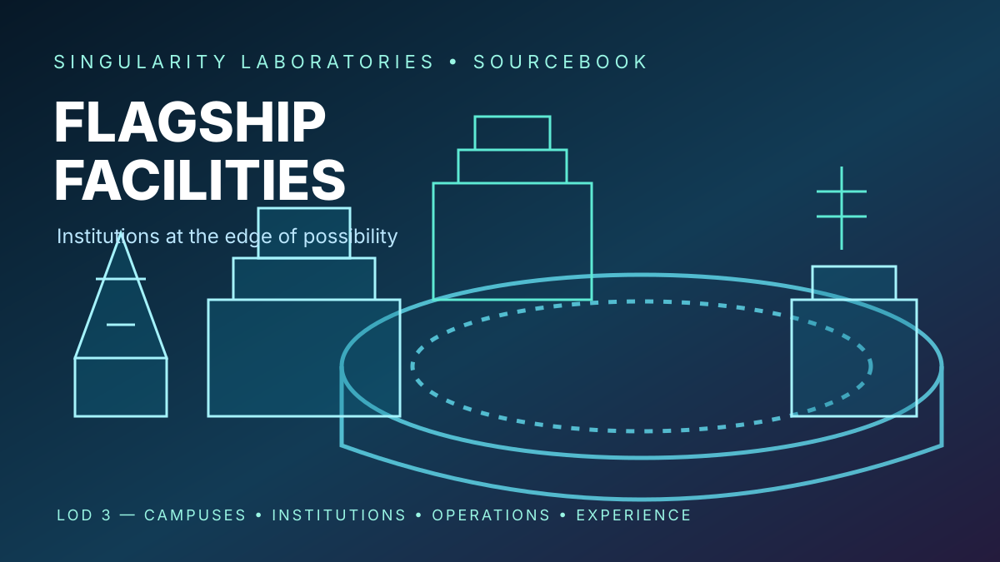

# Flagship Laboratory Facilities — institutions at the edge of possibility




**Domain owner:** Singularity Laboratories  
**Parent domain:** [Laboratory NPCs — LOD 2](laboratory-npcs.md) · [Singularity City — Nonplayer Characters, LOD 1](https://github.com/TrentBest/TheSingularityWorkshop.SingularityCity/blob/development/docs/books/nonplayer-characters.md)  
**Level of detail:** LOD 3 — complete facility, institution, campus, and operational experience  
**Status:** Research-informed sourcebook and composition blueprint. Profiles distinguish documented real facilities, literary fiction, and original speculative designs. They are not claims that these facilities or simulations have been implemented in the runtime.

A laboratory at this level is more than a room containing equipment. It is a living institution: a mission, a campus, a network of buildings and controlled spaces, people and service systems, instruments, utilities, research programs, archives, safety and security governance, funding, visitors, education, maintenance, and a history of discoveries and failures.

The purpose of this book is to make such institutions composable and explorable. A learner should be able to walk into a teaching laboratory; a researcher should be able to follow a reproducible experiment; a visitor should understand why a collider needs an underground ring and detector caverns; a storyteller should be able to explore a gothic fictional laboratory without mistaking it for a historical one.

## 1. LOD inheritance and ownership

LOD 3 inherits rather than duplicates:

- **LOD 1 — Laboratory domain:** laboratory definitions, experiments, apparatus, instruments, measurements, research and education workflows, provenance, and safety metadata.
- **LOD 2 — Laboratory people and operations:** staff and participant relationships, positions, qualifications, assignments, shifts, governance, and review.
- **LOD 3 — Facility institution:** campus composition, buildings, zones, infrastructure, programs, departments, operational rhythms, public interface, and facility-specific narratives.

Singularity City owns the spatial/civic manifestation when a facility is placed in a city: land, roads, public realm, surrounding district, transport, neighboring services, and general resident identity. Singularity Laboratories owns the portable scientific institution and its internal semantics. The same laboratory can be hosted in a City campus, a remote field station, a classroom, a starship, or a game without changing its scientific identity.

Physics owns mathematical and physical models. FSM_Execution owns workflow lifecycle and execution. FSM_COS composes the experience. Trusted hosts enforce identity, permissions, physical access, workload isolation, and data protection. Renderer and Visualize present the facility and its live state.

## 2. What makes a facility a facility?

A facility definition should be assembled from explicit, versioned parts:

| Layer | Examples |
|---|---|
| Institutional identity | Mission, charter, governance, operator, funding model, history |
| Campus and site | Geography, climate, geology, access perimeter, neighboring community |
| Buildings and zones | Offices, clean rooms, halls, control rooms, workshops, archives, visitor areas |
| Scientific programs | Disciplines, research groups, education, service programs, collaborations |
| Apparatus and instruments | Equipment, detectors, microscopes, telescopes, test stands, calibration systems |
| Utilities and infrastructure | Power, cooling, ventilation, vacuum, water, networking, waste, transport |
| People and organization | Leadership, researchers, technicians, operators, educators, visitors, contractors |
| Operations | Shifts, maintenance, scheduling, incident response, change control, handovers |
| Governance | Safety cases, access classes, environmental obligations, peer review, audit |
| Information | Publications, experiment records, datasets, archives, provenance, public interpretation |
| Experience | Wayfinding, tours, demonstrations, interactive displays, accessibility, narrative layers |

A building is not automatically a laboratory. A campus can host many laboratories. A single scientific facility can span multiple buildings or sites. A virtual facility may contain rooms and instruments without claiming to reproduce a real physical site.

## 3. Facility fidelity and truth labels

Every facility and every major feature must declare its evidence class:

- **Documented real:** supported by authoritative public sources. Use accurate names, publicly documented mission, broad layout, and published facts.
- **Reconstructed:** an interpretation of a real facility based on public material. Label uncertain geometry, omitted spaces, and inferred workflows.
- **Fictional source adaptation:** derived from a literary or screen work. Respect the source's chronology and distinguish adaptation from canon.
- **Original speculative:** invented institution or technology. State the assumptions and intended genre.
- **Hybrid experience:** a clearly labeled combination of real-world inspiration and fictional systems.

A visual model is not evidence of physical accuracy. A real-world site profile must not imply access to restricted rooms, classified programs, non-public schematics, or current security arrangements. Never fill gaps in public knowledge with confident invention.

## 4. Flagship facility profiles

### 4.1 Frankenstein's laboratory — the ethics of making life

**FICTIONAL SOURCE ADAPTATION**

**Source anchor:** Mary Shelley's *Frankenstein; or, The Modern Prometheus* (1818). The novel is the literary source; modern film imagery is not automatically canonical.

**Facility identity:** Victor Frankenstein's working spaces are best treated as a narrative sequence rather than one definitive, universally fixed campus. The novel's settings, studies, rooms, and later isolated workshop episodes can inspire a modular fictional research environment. The famous visual shorthand of a storm-lit tower, electrical arcs, bubbling glassware, and a laboratory assistant belongs largely to later adaptations and should be labeled as such.

**Experience thesis:** The player or learner enters a place where scientific ambition has outrun ethical responsibility. The central subject is not a recipe for creating life; it is the relationship between knowledge, consent, care, accountability, isolation, and the consequences of abandoning one's creation.

**Facility composition:**
- Private study and natural-philosophy library: notebooks, correspondence, historical instruments, disputed theories.
- Workshop: workbenches, mechanical fixtures, glassware as non-operational set dressing, specimen documentation, and incomplete prototypes.
- Observation room: journals, sketches, testimony, and conflicting accounts.
- Living quarters: the human cost of obsession, isolation, and secrecy.
- Abandoned or sealed wing: a narrative space for consequences, not a how-to laboratory.
- Archive and memorial: preserve the creature's perspective and the voices of people affected.

**People:** Victor as principal investigator and unreliable narrator; assistants and suppliers as distinct supporting characters; the Creature as a person with agency, memory, needs, and a voice—not equipment, property, or an experiment result. The Creature must not be reduced to a monster-shaped apparatus.

**Core systems:** document provenance, conflicting testimony, consent and personhood, institutional review (or its absence), emotional and social consequence, and the difference between observation and interpretation. No actionable biological, chemical, electrical, or medical procedure is required or appropriate.

**LOD 3 scenarios:** reconstruct the narrative timeline; compare the novel with selected adaptations; investigate the consequences of missing review and duty of care; let learners debate what obligations arise when a researcher creates or discovers a sentient being.

**Implementation boundary:** This is a fictional narrative facility profile. It is not a historical laboratory reconstruction and does not specify a real process for creating life.

### 4.2 Groom Lake / Area 51 — secrecy, aerospace testing, and evidence

**DOCUMENTED REAL FACILITY · PUBLIC-HISTORY PROFILE**

**Public-history anchor:** The CIA identifies Groom Lake / Area 51 as a remote Nevada test site used for highly classified U-2 and A-12 OXCART reconnaissance aircraft programs and pilot training. The CIA's public account describes the isolation, aircraft access, and the origin of the “Paradise Ranch” nickname. Public facts are not a license to invent current site details.

**Experience thesis:** Explore how a real institution manages experimental aerospace programs under secrecy, how test evidence is collected, and how the public interprets incomplete information. The dramatic tension comes from the gap between documented history, legitimate classification, rumor, and the limits of what outsiders can know.

**Safe public-facing composition:**
- Public history and declassification gallery: chronology, source documents, aircraft development context, and clear citations.
- Generic flight-test engineering hall: abstract, non-sensitive examples of instrumentation, telemetry, reliability, and test evidence.
- Pilot and engineering briefing room: decision records, risk communication, and human factors.
- Materials and environmental test exhibit: high-level demonstrations of heat, vibration, fatigue, and measurement concepts.
- Records and evidence room: provenance, redaction, uncertainty, and source comparison.
- Public boundary / landscape interpretation: explain the site's remote setting without mapping sensitive access routes or security systems.

**People:** historians, archivists, aerospace engineers, test personnel represented at a broad public-history level, safety staff, program leadership, and visitors. Do not invent named current employees or depict private individuals as fact.

**Core systems:** experiment/test planning at a conceptual level; instrument calibration; evidence custody; configuration control; redaction; public versus restricted information classification; rumor-versus-evidence comparison.

**LOD 3 scenarios:** compare a declassified historical source with a popular claim; identify what a test record can and cannot establish; examine why a remote test range is selected; explore the ethics of secrecy, oversight, and public accountability.

**Hard boundary:** Do not attempt to reproduce classified aircraft designs, current site layouts, access controls, patrol patterns, operational procedures, or sensitive capabilities. This profile is an educational interpretation of public history, not a simulation of restricted operations.

### 4.3 CERN and the Large Hadron Collider — a distributed instrument at planetary scale

**DOCUMENTED REAL FACILITY · SCIENCE CAMPUS PROFILE**

**Public anchors:** CERN describes the LHC as a 27-kilometre accelerator in a tunnel about 100 metres underground on the Franco-Swiss border near Geneva. It is part of a wider accelerator complex and serves major experiments including ATLAS, CMS, ALICE, and LHCb. These are separate collaborations and detector facilities, not decorative rooms around one machine.

**Experience thesis:** Make the invisible legible. Visitors should understand that a collider is a chain of accelerators, magnets, cryogenics, radio-frequency systems, vacuum, controls, detectors, computing, international collaboration, and long-running scientific analysis—not simply a circular tunnel.

**Facility composition:**
- Accelerator complex: staged beam preparation and transfer represented as a linked system.
- Underground ring: a spatial overview of the LHC circumference, tunnel, sectors, and service systems.
- Detector caverns: distinct interpretive zones for ATLAS, CMS, ALICE, and LHCb, with their scientific questions and detector concepts.
- Control centre: operational overview, machine states, shift coordination, alarms, and safe visualization of public status data.
- Cryogenics and magnet gallery: superconductivity and low-temperature concepts.
- Computing and data centre: event reconstruction, distributed analysis, storage, and collaboration.
- Surface campus: offices, workshops, meeting spaces, visitor centre, education, and international community.
- Accelerator predecessor exhibits: explain how earlier machines feed the LHC and support other experimental programs.

**People:** accelerator operators, engineers, cryogenic and electrical specialists, detector teams, physicists, computing and data specialists, technicians, safety professionals, administrators, students, and visiting collaborators. Use the LOD 2 staffing model to express shift coverage and handovers.

**Core systems:** machine lifecycle visualization; detector event display; calibration and data-quality concepts; model/version provenance; collaborative analysis; public status integration; multi-scale visualization from subatomic event to campus.

**LOD 3 scenarios:** follow a proton's conceptual journey through the accelerator chain; compare the scientific roles of the four major experiments; inspect a detector event display; trace how raw observations become reconstructed data and a peer-reviewed result; simulate a shift handover using synthetic status data.

**Fidelity boundary:** A 3D ring at the correct scale is not a beam-dynamics model. A synthetic event display is not CERN data. Use public datasets and documented parameters where licensed and available; label synthetic observations. Physics owns the underlying scientific models.

### 4.4 Jet Propulsion Laboratory — a laboratory whose instruments travel

**DOCUMENTED REAL FACILITY · ROBOTIC EXPLORATION**

**Public anchor:** NASA describes JPL as a federally funded research and development center managed by Caltech, based in Pasadena, and a leader in robotic space exploration. Its work includes spacecraft, rovers, Earth-observing instruments, and operation of the Deep Space Network.

**Experience thesis:** The laboratory is not only the campus. Its work extends through spacecraft assembly, launch, cruise, planetary operations, ground antennas, navigation, and long-lived mission archives.

**Facility composition:** mission design studios; spacecraft assembly and clean integration spaces; instrument laboratories; robotics test areas; mission operations and visualization rooms; communications and Deep Space Network interpretation; science data archives; public education and visitor exhibits.

**People:** mission scientists, systems engineers, flight software and operations teams, robotics specialists, technicians, navigators, instrument teams, data analysts, educators, and partner institutions.

**Core systems:** mission lifecycle, spacecraft configuration, instrument calibration, command/telemetry concepts, navigation and communications latency demonstrations, rover mobility visualization, and long-term data provenance.

**LOD 3 scenarios:** plan a fictional rover traverse using a clearly labeled simplified terrain model; trace a measurement from instrument to ground archive; compare planned and observed mission states; experience how communication delay changes operations.

**Fidelity boundary:** Mission control imagery and rover scenes must not be mistaken for live operational access. Use public mission data with its provenance and license; simulated telemetry must be visibly marked.

### 4.5 European Molecular Biology Laboratory — one institution across multiple sites

**DOCUMENTED REAL FACILITY · DISTRIBUTED RESEARCH NETWORK**

**Public anchor:** EMBL describes itself as one organization across six European sites: Barcelona, Grenoble, Hamburg, Heidelberg, Hinxton, and Rome. The sites host different research units, services, and facilities, spanning areas such as tissue biology, structural biology, infection biology, computational biology, epigenetics, and neurobiology.

**Experience thesis:** A world-class laboratory need not be one giant building. It can be a distributed institution with shared governance, specialized local facilities, common data practices, training, and international collaboration.

**Facility composition:** a multi-site campus graph; local research buildings and core facilities; shared data and training services; instrument booking and service workflows; collaboration spaces; public science communication; and cross-site project rooms.

**People:** research groups, facility scientists, instrument specialists, data and software teams, educators, administrators, visiting researchers, and partner organizations.

**Core systems:** multi-site identity and facility discovery; sample and dataset provenance; service requests; instrument scheduling; shared research projects; training records; cross-site collaboration and governance.

**LOD 3 scenarios:** route a research question to a specialist site; request a core-facility service; follow a dataset across locations; compare local autonomy with institution-wide standards.

**Fidelity boundary:** The six-site network is documented; any room-level virtual campus beyond public material is a labeled reconstruction, not a claim about actual floor plans.

### 4.6 Los Alamos National Laboratory — a multidisciplinary national laboratory

**DOCUMENTED REAL FACILITY · NATIONAL LABORATORY**

**Public anchor:** Public Department of Energy material describes Los Alamos as a multidisciplinary laboratory founded in 1943, with broad capabilities across physics, materials, bioscience, computing, engineering, and national-security science. Its mission and history require careful treatment.

**Experience thesis:** Show how a national laboratory combines basic research, applied science, major shared facilities, engineering, stewardship, and public accountability across a large institutional campus.

**Facility composition:** scientific divisions; computational research; materials and measurement facilities; environmental and earth science; high-performance computing; education and collaboration; archives and public-history interpretation; and governance spaces.

**People:** scientists, engineers, technicians, computing specialists, safety professionals, environmental specialists, facility operators, administrators, students, and visiting collaborators.

**Core systems:** multidisciplinary project portfolios; facility access and scheduling; shared instrument services; computational resource allocation; safety and environmental review; publication and data provenance.

**Hard boundary:** The experience remains at the level of public mission, history, and non-sensitive science. It must not reproduce weapon design, restricted facilities, sensitive procedures, or operational security details.

## 5. Original speculative facilities — beyond today's institutions

These are original design patterns, not claims about existing facilities. They extend the same LOD model into future science and civilization-scale infrastructure.

### 5.1 The Helios Observatory — a solar-system research network

A distributed observatory whose instruments occupy Earth, orbit, lunar sites, and robotic platforms. Its campus is a network of mission nodes, data relays, calibration facilities, and science teams. LOD 3 must model communication delay, local autonomy, instrument health, mission windows, and the provenance of observations. It should not imply instantaneous communication across astronomical distances.

### 5.2 The Deep-Time Earth Laboratory — planetary processes

A field-and-compute institution combining geological field stations, ocean and atmosphere observations, sample archives, simulation facilities, and long-term environmental records. The central experience is comparing timescales: a sensor reading, a seasonal cycle, a glacial record, and geological history. Physics and Earth-science models own the calculations; Labs owns experiment definition, measurement plans, and provenance.

### 5.3 The Living Systems Institute — ecology and synthetic environments

A research campus connecting contained educational ecosystems, ecological observation, imaging, computational models, and conservation research. Its experience must emphasize containment boundaries, organism welfare, environmental ethics, and uncertainty. Do not treat living organisms as disposable props or provide harmful biological procedures.

### 5.4 The Materials Foundry — matter from atomic hypothesis to engineered structure

A materials research institution linking microscopy, characterization, computational materials science, mechanical testing, fabrication education, and lifecycle analysis. It connects scales without pretending that one model spans every scale with equal validity.

### 5.5 The Interstellar Research Station — science beyond Earth

A remote facility designed around radiation exposure, power scarcity, thermal management, delayed communications, repairability, crew health, and instrument autonomy. Its first-class features are logistics, maintenance, redundancy, and human factors—not merely futuristic architecture.

### 5.6 The Archive of Unanswered Questions — a civilization-scale research commons

A long-lived institution that preserves hypotheses, negative results, unresolved observations, models, datasets, and the history of scientific disagreement. It treats reproducibility and intellectual honesty as infrastructure. Its core question is how knowledge survives changes in people, institutions, technologies, and civilizations.

## 6. Facility operations as a living system

Every flagship facility should expose a coherent operational loop:

1. **Plan:** define mission, question, resources, dependencies, review requirements, and intended outcomes.
2. **Prepare:** verify instrument state, calibration evidence, staffing, qualifications, environmental conditions, and admission policy.
3. **Operate:** execute through the appropriate FSM_Execution workflow and trusted host controls.
4. **Observe:** collect measurements with units, uncertainty, timestamps, instrument identity, and provenance.
5. **Assess:** validate data quality, compare against expectations, record anomalies, and review limitations.
6. **Preserve:** store immutable run identity, configuration, model versions, evidence, and authorship.
7. **Learn:** update hypotheses, training, maintenance, facility plans, and future experiment designs.

The facility should continue to feel alive between headline experiments: equipment is maintained, people arrive and leave shifts, classes run, deliveries are received, data is processed, visitors are guided, reviews are pending, and archives grow. These rhythms may be represented at different LODs; do not simulate every individual when an aggregate state is sufficient.

## 7. Spatial and temporal LOD

A facility should scale gracefully:

- **LOD 0:** a facility exists; its purpose, status, and relationship to its host are known.
- **LOD 1:** the campus and major buildings are visible as a navigable composition.
- **LOD 2:** departments, zones, staff, operational states, and major instruments become inspectable.
- **LOD 3:** rooms, workstations, instrument interfaces, experiment sessions, and individual people are represented where useful.
- **LOD 4+:** selected instruments, physical phenomena, workflows, and measurements are expanded to the fidelity supported by their owning models.

This spatial LOD is a presentation policy and must not be confused with the sourcebook's domain LOD numbering. A high-detail room does not imply high scientific fidelity. A low-detail campus can still carry exact institutional metadata.

Temporal fidelity is also explicit: live observation, recorded historical data, replay, synthetic demonstration, and speculative future scenario must be distinguishable.

## 8. Facility record — proposed composition contract

The following is a conceptual shape for sourcebook authoring, not a committed runtime API:

```text
Facility
  Identity: stable id, title, version, truth class
  Institution: mission, charter, operator, governance
  Site: host location, campus graph, environmental context
  Buildings: zones, access classes, public/private boundaries
  Programs: disciplines, projects, education, services
  Components: laboratories, apparatus, instruments, utilities
  People: City character references, LOD 2 assignments and qualifications
  Operations: schedules, shifts, maintenance, readiness, incidents
  Evidence: sources, datasets, model versions, review records
  Experience: entry points, tours, interfaces, narrative layers
  Fidelity: geometry, science, data, temporal mode, limitations
```

Do not implement this conceptual shape until the repository's existing contracts and tests have been reviewed and the owning maintainers agree on the boundary. In particular, do not duplicate City character records, Physics models, FSM_Execution lifecycle, or host authorization.

## 9. Validation matrix

A facility profile is ready for a credible experience only when it can answer:

- What is documented, reconstructed, fictional, or speculative?
- Who owns the scientific models and what fidelity do they support?
- What is the institution's mission and who is accountable?
- How do people, positions, qualifications, and shifts relate?
- What instruments and utilities are essential to the facility?
- What data is live, historical, synthetic, or replayed?
- What happens when an instrument is unavailable or a shift is understaffed?
- How are safety review, access, and independent oversight represented?
- Can a user follow one observation from instrument to result and archive?
- Can the experience run as a campus, remote facility, classroom, research workspace, or game location without changing the canonical science records?

## 10. Sources and further exploration

Public factual profiles should be refreshed against authoritative sources when the book is revised.

- [CIA — What really went on at Area 51?](https://www.cia.gov/stories/story/ask-molly-what-really-went-on-at-area-51/) — public account of U-2 and A-12 OXCART history.
- [CIA — Area 51 and the Accidental Test Flight](https://www.cia.gov/stories/story/area-51-and-the-accidental-test-flight) — Groom Lake, U-2 testing, and the early site history.
- [CERN — The Large Hadron Collider](https://home.cern/science/accelerators/large-hadron-collider/) — accelerator overview and public facts.
- [CERN — Accelerator complex](https://home.cern/science/accelerators/accelerator-complex/) — the wider accelerator chain and experimental program.
- [CERN — Experiments](https://home.cern/science/experiments/) — detector collaborations and scientific focus.
- [NASA — Jet Propulsion Laboratory history](https://www.nasa.gov/jpl/jet-propulsion-laboratory-history/) — JPL origins, mission, and institutional history.
- [EMBL — About](https://www.embl.org/about/) — six-site institutional model and research missions.
- [U.S. Department of Energy — National Laboratories](https://www.energy.gov/national-laboratories) — national-laboratory context and public mission summaries.
- [Mary Shelley — Frankenstein (Project Gutenberg)](https://www.gutenberg.org/ebooks/84) — primary literary source for the fictional profile.

## 11. Implementation status and next steps

This sourcebook is a research-informed design and authoring artifact. It does not assert that any of the featured real facilities have been reconstructed, that their internal systems are accessible, or that the runtime currently simulates a full institutional campus.

The next implementation stages should be incremental:

1. Establish a sourcebook catalogue and validate the descriptor/cover/LOD badge convention.
2. Build the [Teaching and Research Campus specimen](../specimens/teaching-research-campus.md) as the first facility implementation, using its visitor, lesson, research, instrument, resource, and security acceptance flows.
3. Add a CERN-inspired public educational collider experience using documented public facts and synthetic data until a verified dataset adapter exists.
4. Add facility composition and navigation only after checking current Laboratory and City contracts.
5. Extend the staff/qualification/shift model only after reviewing the current assignment implementation and tests.
6. Add further real-world profiles through source-backed research; keep sensitive and restricted details out.
7. Connect live observations only through real, attributable adapters. Never invent a live status feed.

The ambition is not to build static museum scenery. It is to make a laboratory feel like a real, accountable, evolving institution—while preserving the boundary between what is known, what is modeled, and what is imagined.
