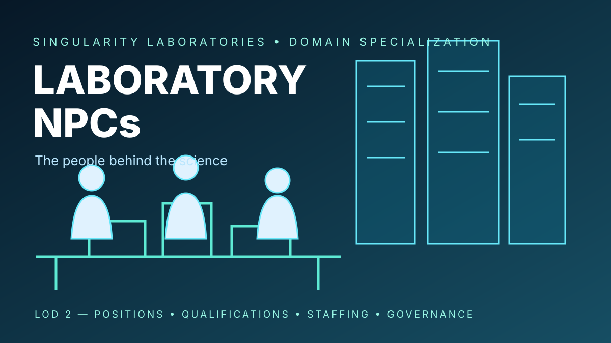

# Laboratory NPCs — the people behind the science

**Domain owner:** Singularity Laboratories  
**Parent domain:** [Singularity City — Nonplayer Characters, LOD 1](https://github.com/TrentBest/TheSingularityWorkshop.SingularityCity/blob/development/docs/books/nonplayer-characters.md)  
**Level of detail:** LOD 2 — laboratory-specific people, positions, qualifications, staffing, and operational relationships  
**Status:** Domain sourcebook and design contract. This does not claim that a complete workforce simulator, HR system, credential authority, or hardened security service is implemented.

A laboratory is not just rooms, instruments, and experiment definitions. It is a working institution whose people establish questions, maintain apparatus, teach, review, protect, investigate, document, and make decisions. This book specializes the general City NPC model for laboratory contexts. A researcher remains the same continuing character when they leave the lab, visit a city, join a starship, or become a player character.

## 1. Scope and inheritance

This LOD 2 book inherits identity, continuity, capabilities, limitations, knowledge, motivation, relationships, agency, and population representation from the City LOD 1 book. It adds laboratory-specific responsibilities and operational context.

Singularity Laboratories owns portable laboratory semantics: experiment definitions, facilities, apparatus, instruments, measurement workflows, research and education workflows, staff responsibility records, and laboratory governance. Singularity City may manifest a laboratory as a building, campus, district, or destination and provide residents, social context, and spatial navigation. City does not define laboratory safety policy or scientific workflow.

## 2. Laboratory participants are not all staff

| Participant relationship | Typical examples | Meaning |
|---|---|---|
| Staff | Owner, administrator, safety officer, PI, instructor, technician, researcher | Holds an institutional responsibility or position |
| Learner | Student, apprentice, trainee | Participates in an educational activity |
| Guest | Visitor, collaborator, public-tour attendee | Has a bounded visit or collaboration relationship |
| Reviewer | Internal or external scientific/safety reviewer | Evaluates a defined artifact or process |
| Contractor | Facilities engineer, calibration provider, cleaning staff | Performs scoped services under an agreement |
| Observer | Auditor, sponsor, invited observer | Has a defined observation purpose and scope |
| Service identity | Instrument controller or scheduled automation | Non-human digital principal, not an NPC/person |

One character may hold more than one relationship, but those relationships must be explicit. A learner is not automatically staff; a reviewer is not automatically an operator; a guest is not automatically authorized to handle apparatus.

## 3. Person, account, qualification, position, and permission

These are distinct records:

- **Character identity:** the continuing person in the represented world, owned by the general NPC domain.
- **Host principal:** an opaque identity reference issued by the trusted host for a digital account or service identity.
- **Qualification:** evidence that a person meets a declared competence standard, with issuer, scope, evidence, issue date, expiry or renewal, and status.
- **Position:** a stable institutional need such as Safety Officer, Instrument Technician, or Principal Investigator.
- **Role:** a responsibility bundle in a laboratory context.
- **Assignment:** a time-bounded placement of a person or host principal into a position or responsibility.
- **Authority:** a defined decision right, such as approving a local operating procedure or accepting a review.
- **Authorization:** a trusted host decision permitting a specific digital action on a resource.

A City character ID must not be assumed to be a host principal ID. One character may have no digital account; a host principal may represent a service identity; one character may interact through different accounts in different hosts. The current `LaboratoryStaffAssignment` stores an opaque host-issued `PrincipalId` and a laboratory responsibility. It does not currently store a City NPC ID, prove a qualification, or grant digital permissions. Any future mapping requires an explicit trusted identity-link contract.

A qualification does not automatically confer a position. An assignment does not prove competence. A fictional title does not grant a digital permission. A user-interface badge is not an authorization decision.

## 4. Laboratory positions and responsibilities

These are role families, not a mandatory universal org chart. A small classroom lab may combine responsibilities; a national research facility may split them across teams and shifts.

| Position / responsibility | Primary duties | Typical evidence or qualification |
|---|---|---|
| Laboratory Owner / Director | Purpose, stewardship, institutional accountability, resourcing | Appointment or governance record |
| Laboratory Administrator | Membership workflow, configuration, operational coordination | Administrative training and delegated scope |
| Principal Investigator | Research direction, hypothesis, scientific accountability | Relevant expertise and appointment |
| Safety Officer | Hazard register, safety review coordination, incident readiness, stop-work escalation | Appropriate safety training and delegated authority |
| Researcher / Scientist | Hypothesis, methods, observations, interpretation, reproducibility | Field-specific education or demonstrated competence |
| Laboratory Technician | Apparatus readiness, setup, maintenance, calibration coordination | Instrument- and method-specific training |
| Instrument Specialist | Operation and maintenance of specialized measurement systems | Instrument-specific qualification and authorization |
| Instructor / Educator | Lessons, demonstrations, learner supervision, assessment | Teaching and subject-matter competence |
| Data Steward | Data classification, provenance, retention coordination, dataset quality | Data governance and domain competence |
| Quality / Validation Reviewer | Independent review of methods, evidence, and model claims | Relevant expertise and independence |
| Facilities / Environmental Operator | Utilities, environmental controls, building systems, maintenance coordination | Facility-specific training and authorization |
| Emergency Coordinator | Communication, evacuation coordination, incident roles | Site-specific emergency training and appointment |
| Custodian / Support Staff | Housekeeping and approved support services | Task-specific training and access scope |

The institution defines its actual positions, reporting relationships, capacity, shift coverage, and required competencies. These examples do not mean every laboratory needs every position.

## 5. Qualifications and competence

A qualification record should identify the person, competence/activity covered, issuing authority and evidence, applicable laboratory/facility/instrument/method scope, issue and review dates, expiry or renewal condition, current status, limitations, supervision requirements, and accommodations.

Training attendance, demonstrated competence, certification, appointment, and authorization are distinct. A person can be trained but not currently qualified; qualified but not assigned; assigned but awaiting host authorization; or authorized for one instrument but not another. Do not infer competence from seniority, rank, job title, reputation, or a single broad skill score.

## 6. Staffing, shifts, and continuity

Laboratory operations require coverage, not just a list of names. Model:

- Positions required for a facility, experiment class, instrument, or shift.
- Minimum/maximum staffing and required combinations of competencies.
- Primary, secondary, supervisory, and on-call coverage.
- Shift start/end, handover, rest, absence, leave, and temporary reassignment.
- Vacancies, succession, escalation, and continuity during an incident.
- Fatigue, workload, training, and human-factor constraints.
- Assignment history and the reason for each change.

A laboratory should be able to determine that a role is vacant, a shift is under-covered, a qualification has expired, or a required independent reviewer is unavailable. Do not silently fill a missing role with an unqualified person or an automated agent.

## 7. Safety governance and separation of duties

Safety is an institutional process supported by evidence and trusted controls. Distinguish hazard identification and disclosure, risk assessment and review, training and qualification, operational responsibility and stop-work authority, approval of a procedure or experiment, digital authorization, and incident response.

Where independence matters, policy must prevent a person from approving their own work or bypassing a required second reviewer. Role combinations and separation-of-duty rules are institution- and activity-specific; this book does not prescribe one universal policy.

The Safety Officer is not a permission token. The role records responsibility and escalation authority in the institution; the host enforces digital permissions and physical controls. Scientific validation, experiment safety assessment, and personal qualification remain separate evidence.

This sourcebook avoids operational instructions for hazardous experiments. It describes accountable staffing, governance, and review boundaries, not procedures for producing dangerous materials or devices.

## 8. Laboratory character behavior

A useful professional behavior cycle is **Observe → interpret evidence → consider scientific and institutional obligations → assess permitted options → decide → act or escalate → record outcome → learn**.

Examples:
- A technician notices instrument drift and marks it unavailable pending the laboratory's calibration process.
- A researcher challenges an interpretation because uncertainty exceeds the claimed effect.
- A safety officer pauses an activity when a declared prerequisite is absent and records why.
- An instructor adapts a lesson for a learner's accessibility needs without changing the scientific result.
- A principal investigator delegates a task but remains accountable for the declared research scope.
- A visiting reviewer asks for provenance and limitations before accepting a result.

These are behavioral examples, not implemented autonomous-agent capabilities.

## 9. Example staffing patterns

### Small teaching laboratory
One instructor may also be local administrator. A technician supports scheduled sessions. Learners are enrolled participants, not staff. An external reviewer evaluates course design but does not become an instrument operator.

### University research group
A principal investigator leads research; researchers and graduate students conduct work; technicians maintain equipment; a department-level safety function reviews relevant hazards. Duties may be shared across the institution.

### National facility or collider campus
Multiple instrument teams, operations shifts, facility engineering, data stewardship, safety governance, emergency coordination, visiting researchers, and independent review operate across a large campus. City may represent buildings and transit; the laboratory domain owns operational roles and scientific workflows.

### Remote or automated laboratory
A host may schedule an instrument service identity for a bounded operation. The service identity is not a human NPC. A responsible human owner, operator, or reviewer remains separately attributable according to policy. Automation does not erase accountability.

## 10. Relationship to current contracts

The current `LaboratoryStaffAssignment` is an initial responsibility record with laboratory ID, opaque host `PrincipalId`, role, assigning principal, assignment time, and optional expiry. It does not yet model a stable position entity, a City character link, qualification evidence, shift coverage, revocation history, or separation-of-duty policy. Those are future contracts and must be added deliberately rather than inferred from the current enum.

The governance document describes the host boundary: identity providers authenticate; trusted hosts authorize and enforce; the laboratory domain records responsibilities, safety disclosures, and review evidence. Never store credentials in laboratory domain records.

## 11. Cross-domain ownership

| Concern | Owner |
|---|---|
| General person, resident, NPC identity and agency | Singularity City |
| Laboratory definitions, staff responsibilities, qualifications in lab context, experiment governance | Singularity Laboratories |
| Scientific models, equations, numerical methods | Physics |
| Workflow lifecycle, cancellation, execution | FSM_Execution |
| Composition of capabilities | FSM_COS |
| Authentication, digital authorization, secrets, enforcement | Trusted host / security platform |
| Tabletop interpretation and campaign procedures | SURPS |
| Presentation and spatial manifestation | City host / Renderer / Visualize |

## 12. Implementation boundary and next validation

The current repository contains a host-neutral `LaboratoryStaffAssignment` contract and tests. It is not a full HR, identity, access-control, scheduling, or workforce platform. This LOD 2 sourcebook is the domain design and validation guide for extending it.

Validate against: (1) a one-room teaching lab with an instructor, technician, and learners; (2) a multi-team research facility with independent safety and scientific review; (3) a shift-based instrument facility with handovers, absences, and expiring qualifications; (4) a remote lab where a service principal runs a bounded task while a human remains accountable; and (5) a character who is a City resident, lab employee, and player character at different times without identity duplication.
