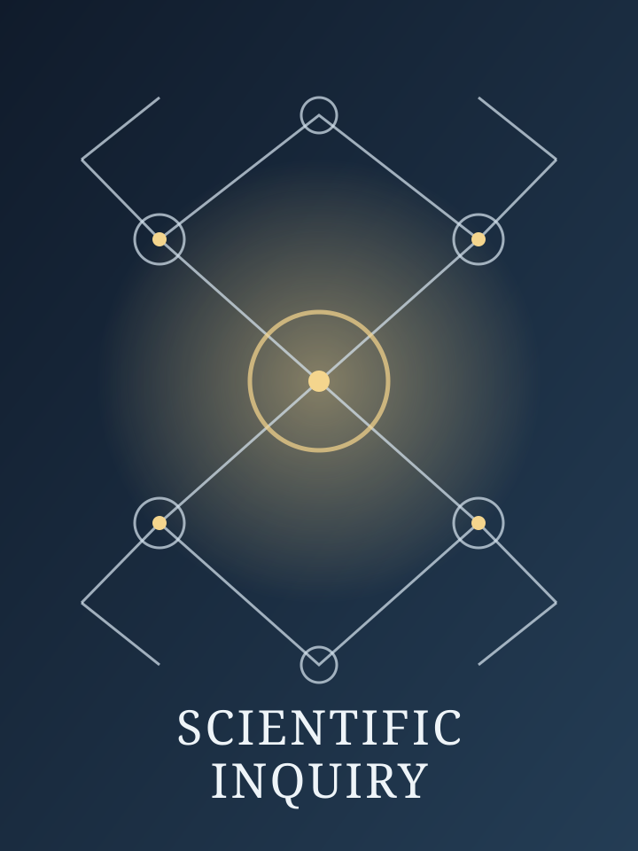
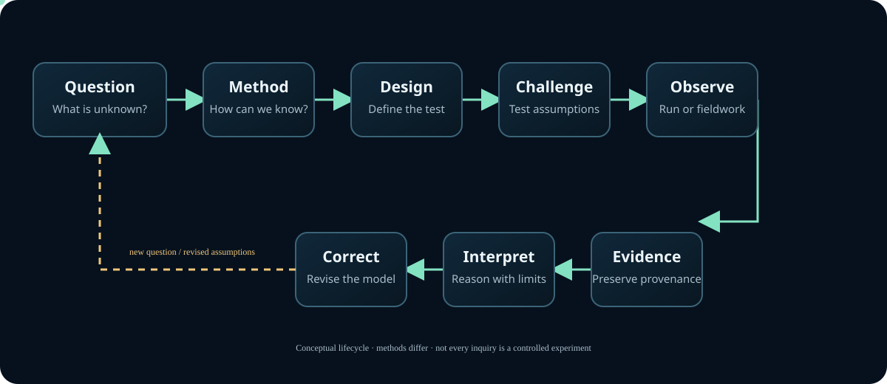

# Scientific Inquiry

*the methods and history of knowing*

**Sourcebook ID:** `singularity-laboratories.domain.scientific-inquiry`  
**Edition:** `0.1.0`  

**Domain owner:** Singularity Laboratories  
**Level of detail:** LOD 1 — scientific foundations, inquiry methods, history, evidence, and reproducibility  
**Status:** Foundational sourcebook; linked chapters are living research documents

Science is not a checklist or a collection of impressive instruments. It is a human enterprise for asking questions, building explanations, collecting and challenging evidence, and correcting what we think we know. This sourcebook is the methodological and historical spine of Singularity Laboratories.

## How to use this book

- **New learners:** begin with the question-and-evidence chapters, then compare the method families.
- **Researchers:** use the methods atlas to justify a method, disclose assumptions, and identify limits.
- **Instructors:** choose one worked investigation, ask learners to predict what evidence would change their minds, and adapt the exercise to the class.
- **Laboratory authors and reviewers:** use the implementation and integrity links to distinguish a method description from an executable provider or validated model.

## Player / researcher overview

A participant begins with a question, not an instrument. They choose an approach that can produce relevant evidence, state what they expect to observe, collect or inspect the evidence, and explain what it does and does not support. A good investigation makes it possible to be surprised and to revise the original expectation.

## Game Master / Workshop overview

The Workshop author selects a method family, defines the intended inference, records assumptions and exclusions, identifies the required sources or providers, and prepares boundary cases. The editor should be able to change the investigation without silently changing its scientific meaning. The instructor or facilitator exposes enough of the method to teach reasoning while keeping advanced analysis available.

## Living domain map

The lifecycle is a teaching map, not a universal five-step recipe. Different methods use different evidence and validation practices; some investigations are iterative, comparative, interpretive, or proof-based rather than experimental.

## Methods in action

### Field observation

A watershed team asks whether a reach changes after a storm. It records the location, time, sampling method, weather context, observer, and uncertainty. The observation can support a description of conditions at that place and time. It does not by itself establish which upstream process caused the change.

### Computational investigation

A researcher asks how a model responds when one declared parameter changes. They preserve the model version, configuration, supported range, and output. The comparison describes the behavior of that model under those inputs; it is not a measurement of the physical system unless independently connected to a real measurement process.

## Adapter views

The human method is the reasoning and record-keeping procedure a researcher can perform with paper, instruments, or conversation. The digital view can validate schemas, bind exact versions, execute providers, and preserve provenance. Neither view changes the underlying question or turns a model output into a measurement.

This sourcebook does not prescribe a universal dice mechanic. A SURPS tabletop experience may present a scientific investigation as part of play, but its player procedure belongs to the selected SURPS rulebook and must remain faithful to the domain method.

## Authoring and reference

The chapter links below are the deeper reference set. Use [Scientific Integrity](../scientific-integrity.md) for validation and safety boundaries, [Reproducibility and Open Science](../reproducibility-and-open-science.md) for durable research records, and the [Core Manual](../laboratory-manual.md) for the complete laboratory journey.

## Core chapters

- [Scientific Inquiry and the Scientific Method](../scientific-method.md) — inquiry cycle, reasoning, methods, experimental design, measurement, evidence, uncertainty, criticism, and correction.
- [A Global History of Scientific Inquiry](../history-of-science.md) — knowledge traditions across civilizations, institutions, instruments, networks, and the modern research enterprise.
- [Research Methods Atlas](../research-methods-atlas.md) — experimental, observational, field, human, mathematical, computational, historical, and synthesis methods.
- [Reproducibility, Replication, and Open Science](../reproducibility-and-open-science.md) — research provenance, computational packages, independent testing, governed sharing, and correction.
- [Scientific Integrity, Validation, and Safety](../scientific-integrity.md) — model fidelity, validation levels, verification, uncertainty, and responsible simulation.

## Teaching principle

Never teach that every science follows the same five steps. Teach a shared commitment to evidence and criticism, then show how methods change with the question, discipline, instruments, ethics, and historical context.

## Implementation principle

Preserve common provenance and review boundaries while allowing method-specific records. Do not force a field observation, mathematical proof, clinical study, historical archive, and computational experiment into one narrow experiment schema.

## Research standards

Historical claims distinguish primary sources, secondary scholarship, established interpretation, contested interpretation, reconstruction, speculation, and fiction. Scientific claims distinguish observation, measurement, model output, interpretation, and conclusion. Neither a beautiful visualization nor a prestigious institution substitutes for evidence.
