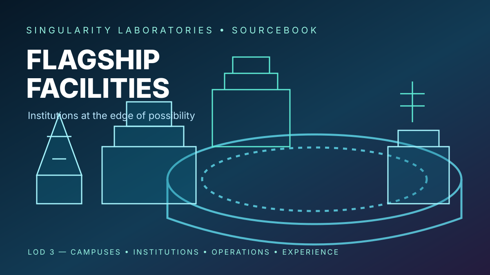

# Singularity Laboratories

**From the subatomic to the astronomical. From a single experiment to a living research institution.**

Singularity Laboratories is the Workshop domain for portable laboratories, experiments, instruments, scientific workflows, education, and research. A laboratory can be hosted in a classroom, research workspace, Singularity City campus, remote field station, starship, or game.

## Explore the sourcebooks

- [LOD 1 — Laboratory domain](../README.md): experiments, apparatus, instruments, measurement, research, education, and provenance.
- [LOD 2 — Laboratory NPCs](books/laboratory-npcs.md): staff, learners, guests, positions, qualifications, shifts, and governance.
- [LOD 3 — Flagship Laboratory Facilities](books/flagship-laboratory-facilities.md): Frankenstein's fictional laboratory, public-history Area 51, CERN's Large Hadron Collider, NASA JPL, EMBL, Los Alamos, and original future institutions.
- [Complete sourcebook catalogue](books/README.md).

## What makes the experience different?

A facility is not merely a collection of rooms. It is an institution with a mission, people, programs, instruments, infrastructure, maintenance, safety and security governance, evidence, archives, and an operational rhythm. Every profile distinguishes documented fact, reconstruction, fiction, and speculation.

## Ownership boundaries

- [Singularity City](https://github.com/TrentBest/TheSingularityWorkshop.SingularityCity) owns the general people, resident, visitor, and NPC identity model and the civic/spatial host.
- Singularity Laboratories owns portable laboratory and experiment semantics, facility composition, and laboratory-specific staffing and governance.
- Physics owns scientific models and numerical methods.
- FSM_Execution owns workflow lifecycle and execution.
- Trusted hosts own authentication, authorization, and enforcement.
- Renderer / Visualize own presentation.

**Implementation status:** These sourcebooks are design and research artifacts. They do not claim that the featured real facilities have been reconstructed or that all described runtime capabilities are implemented.
