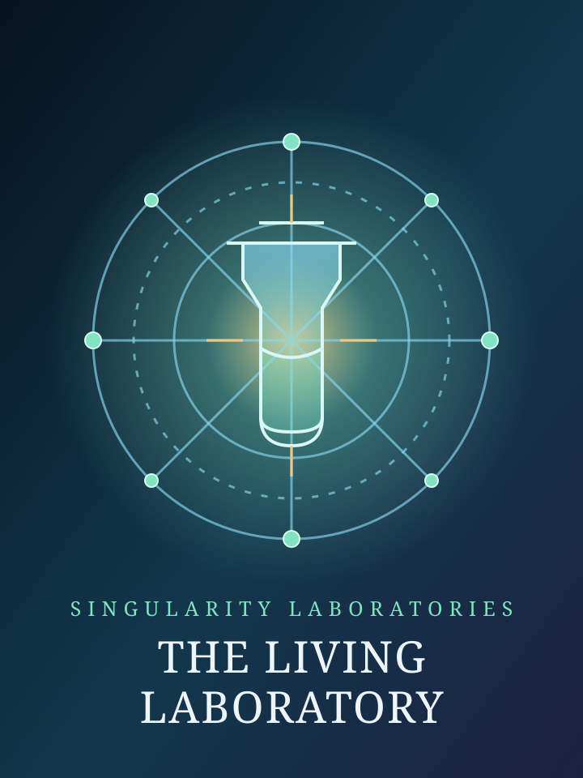
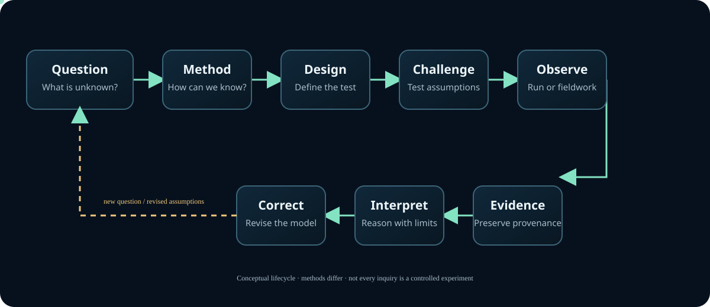
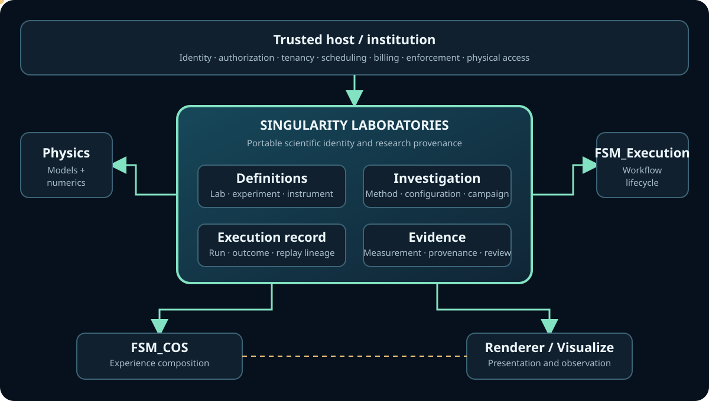

# Singularity Laboratories
## The Living Laboratory — Core Manual

**A portable scientific institution for inquiry, experimentation, education, and research.**

**Development manuscript · Edition 0.1**

> Ask a question. Design an investigation. Challenge the model. Preserve what happened. Make the next decision with evidence.

---

## A note on this edition

This is the primary reader-facing manual for Singularity Laboratories. It is written as a book, not as API documentation: introduction, concepts, principles, how to conduct an investigation, how to operate a virtual laboratory, worked experiences, reference, and appendices.

Singularity Laboratories is an evolving platform. The repository contains implemented experiment and campaign foundations, durable provenance, replay, composition, and workflow integration. Other capabilities—including a complete instrument console, hosted reservations, runtime metering, education services, and campaign analysis—remain specified or planned. This manual labels those states rather than presenting a design target as a finished service.

The digital laboratory is the primary direction. The book is the human-readable companion: it explains what the laboratory means, why its boundaries matter, and how a person can reason about an investigation even when no digital runtime is available. A browser demonstration is not automatically a scientific evaluator, and a simulated result is not a physical measurement.

## How to use this book

- **New visitors:** read *The Big Idea*, *What a Laboratory Owns*, and *The Research Journey*.
- **Learners and instructors:** follow *Learning Through Investigation* and the worked examples. Use the sourcebooks for deeper scientific context.
- **Researchers:** read *Designing an Investigation*, *Evidence and Uncertainty*, *Reproducibility*, and the campaign chapters.
- **Laboratory authors and operators:** use *Building a Laboratory*, *Facilities and Instruments*, *Staff and Governance*, and the technical companion.
- **Digital and host developers:** read *The Platform Boundary*, then continue to the [Technical Companion](laboratory-technical-companion.md) and exact contracts linked from it.
- **Editors and reviewers:** use the sourcebook catalogue, evidence labels, glossary, and appendices to check that claims match implementation and source provenance.

The online edition is nonlinear: follow diagrams, inspect sourcebooks, and open implementation links as needed. The chapter order also works as a conventional book.

## The promise of this book

By the end, you should understand:

1. What a portable laboratory is—and what it is not.
2. How questions, methods, models, instruments, experiments, campaigns, and evidence relate.
3. How to challenge an assumption before relying on a result.
4. How a virtual experiment is configured, admitted, executed, measured, and preserved.
5. How to distinguish observation, measurement, model output, interpretation, and conclusion.
6. How a laboratory can be hosted in different environments without changing its scientific identity.
7. Which capabilities are implemented, specified, planned, or owned by another system.

---

# Part I — The big idea

## 1. A laboratory is a way of asking better questions

A laboratory is not defined by a room, a bench, a collection of expensive instruments, or a building with restricted doors. It is a structured environment for inquiry.

It brings together a question, a method appropriate to that question, the people and capabilities needed to carry it out, the conditions under which evidence is produced, and a record that lets others inspect what happened.

Sometimes that environment is a physical facility. Sometimes it is a field site, a classroom, a computer, a remote instrument, or a virtual model. A laboratory can be portable because its scientific identity is expressed through definitions, methods, instruments, provenance, and evidence—not through one host's walls or user interface.

**The central promise: break it in concept before you try it in reality.**

That promise is about disciplined exploration, not a claim that simulation can replace every physical test. A virtual study can expose assumptions, compare scenarios, reveal sensitivity, and help decide what should be measured next. It cannot certify a real-world process merely because the visualization looks convincing.

## 2. The living laboratory

A useful way to understand the platform is to follow the relationship between inquiry and evidence.

A research question does not always begin with a hypothesis, and an investigation does not always end in a single answer. Observational research, field studies, mathematical proof, historical inference, qualitative inquiry, computational studies, and controlled experiments use different methods. Their shared obligation is to make reasoning, evidence, uncertainty, criticism, and correction visible.

The diagram is a conceptual map of the research lifecycle, not a claim that every stage is automated by the current runtime.

## 3. One laboratory, many hosts

A laboratory can appear in The Singularity Workshop, a classroom, a private research workspace, a remote facility, a game, or a campus inside Singularity City.

The host may provide identity, navigation, spatial presentation, social presence, scheduling, access enforcement, billing, and data protection. The laboratory domain provides scientific definitions, experiment and campaign semantics, measurement context, facility and instrument descriptions, and research provenance.

The same versioned experiment should retain the same scientific identity when it is presented by a different host. A host may change how a researcher sees or enters a laboratory; it must not silently change what a model means.

## 4. The vocabulary of a laboratory

| Concept | Meaning |
|---|---|
| **Inquiry** | A disciplined process for asking, investigating, and revising a question. |
| **Method** | The approach appropriate to the question and the kind of evidence sought. |
| **Model** | A representation of a system, with declared assumptions and a domain of applicability. |
| **Experiment** | A versioned investigation definition that binds a model, parameters, and method-specific context. |
| **Configuration** | The concrete, validated inputs selected for one run. |
| **Instrument** | A defined means of observing, measuring, or interacting with a system. |
| **Measurement channel** | A declared output or observation stream, including units and context where applicable. |
| **Run** | One execution or observation event with a preserved identity and provenance. |
| **Campaign** | A versioned collection of baseline and scenario investigations organized around an objective. |
| **Evidence** | A traceable record supporting or challenging a claim. |
| **Validation** | An assessment of a model, method, or result against stated criteria and evidence. |
| **Reproducibility** | The ability to reconstruct the declared computational or procedural conditions and inspect the relationship to an earlier result. |
| **Facility** | An institution or environment that organizes laboratories, people, instruments, utilities, and programs. |

These are working domain concepts. They do not imply that every concept is already represented by a complete runtime service.

### The researcher’s view

A researcher or learner should be able to move through a simple, understandable path:

1. State the question and why it matters.
2. Choose a method that can produce relevant evidence.
3. Inspect the model, instrument, or source and its limitations.
4. Configure the investigation and identify what would challenge the expectation.
5. Request or conduct the work under the applicable policy.
6. Examine what actually happened, including missing or failed observations.
7. Interpret the evidence within its scope and uncertainty.
8. Preserve the record and decide what question should come next.

The person should not need to understand every implementation detail to make a responsible choice. The interface should expose deeper information when the decision requires it.

### The laboratory author’s Workshop view

An author or operator needs a deeper surface for defining and inspecting the laboratory:

- compose versioned facilities, instruments, apparatus, and measurement channels;
- bind an experiment to an exact model identity and version;
- declare parameter schemas, assumptions, supported ranges, and exclusions;
- prepare templates and baseline/scenario configurations;
- inspect admission decisions and every reason for denial;
- follow execution lifecycle, outputs, failures, cancellation, and provenance;
- compare only compatible measurements and preserve uncertainty;
- review the evidence needed before a claim or handoff is accepted.

Some of these capabilities exist as contracts and workflow foundations; a complete interactive authoring console and campaign analysis surface remain future work.

### A living domain map

The laboratory domain sits between scientific model providers, workflow execution, experience composition, presentation, and the trusted host. The arrows represent integration relationships, not ownership transfer. Physics remains authoritative for physical models; FSM_Execution remains authoritative for workflow lifecycle; the host remains responsible for security and enforcement.

---

# Part II — Conducting an investigation

## 5. Start with the question

A good investigation begins by stating what is not yet known. Avoid starting with a favorite instrument or a simulation that happens to be available.

Ask:

- What do we want to understand?
- Why does the answer matter?
- What kind of evidence could address the question?
- What would count against our current explanation?
- Which assumptions are we making?
- What is outside the scope of this investigation?

A question may be exploratory, descriptive, comparative, causal, predictive, interpretive, or evaluative. Its form should guide the method. Do not force every question into a controlled experiment.

## 6. Choose a method that fits

The method determines what can reasonably be inferred.

| Method family | Typical purpose | Important limitation |
|---|---|---|
| Controlled experiment | Study effects under deliberately managed conditions | Control does not remove every confounder or guarantee external validity |
| Observational study | Describe patterns in naturally occurring conditions | Association alone does not establish causation |
| Field investigation | Study a system in its environment | Conditions may be difficult to isolate or repeat |
| Mathematical proof | Establish a conclusion from explicit premises and valid reasoning | A proof applies to its formal assumptions, not automatically to the physical world |
| Computational study | Explore a formal model or numerical approximation | Output is conditional on model structure, parameters, and numerical behavior |
| Historical inquiry | Reconstruct and interpret past events from sources | Sources can be incomplete, biased, or contested |
| Qualitative research | Understand meaning, experience, and context | Sampling, interpretation, and researcher position must be disclosed |
| Evidence synthesis | Compare and combine existing findings | Quality depends on search scope, inclusion rules, and source quality |

A method can combine several of these families. The choice and its limitations should be recorded before results are interpreted.

## 7. Design before execution

Before running a model or collecting observations, define:

1. **Objective:** the question or decision the investigation supports.
2. **Scope:** the system, population, time interval, and conditions considered.
3. **Method:** why this approach is appropriate.
4. **Baseline:** the reference condition, when comparison requires one.
5. **Factors:** the variables or conditions deliberately changed.
6. **Scenarios:** nominal, boundary, sensitivity, disturbance, tolerance, or other justified cases.
7. **Acceptance criteria:** measurable statements that can be evaluated without rewriting them after seeing the result.
8. **Constraints:** safety, resource, data, ethical, and operational boundaries.
9. **Disclosures:** assumptions, model limitations, and unresolved uncertainty.
10. **Disposition:** what decision may follow—and what decision cannot be justified by this evidence alone.

A campaign is useful when the question is comparative or scenario-based. It is not mandatory for every investigation.

## 8. Challenge the model

A model is not a miniature copy of reality. It is a purposeful representation that omits some things and approximates others.

Ask of every model:

- Which phenomena are represented?
- Which are deliberately excluded?
- What parameter ranges are supported?
- What has been verified against implementation requirements?
- What has been validated against independent observations or reference data?
- What uncertainty remains?
- Under what conditions should the model not be used?

A model can be useful without being validated for every purpose. The correct response to a limitation is to state it, constrain the claim, and identify the evidence needed next.

## 9. Run, observe, and preserve

The laboratory runtime provides a versioned path for experiment definitions, configurations, admission, execution, and run records. The current campaign foundation executes a baseline and scenario configurations through the ordinary experiment runner, records explicit outcomes, and preserves the original campaign definition alongside scenario evidence.

### Adapter views: human inquiry and digital execution

The human-facing procedure and the digital runtime are two views of one investigation, not competing sources of scientific truth.

- **Human/researcher view:** a person can frame the question, select a method, record conditions, observe or measure, document uncertainty, and preserve the reasoning without depending on a particular application.
- **Digital view:** versioned definitions and configurations bind to explicit providers; a host admits the work; FSM_Execution manages lifecycle; the model provider evaluates the request; and immutable records preserve the declared conditions and observed outcomes.
- **SURPS/tabletop use:** Singularity Laboratories does not define a universal dice mechanic or generic tabletop adapter for scientific work. If a SURPS experience uses a laboratory investigation as play, the selected SURPS rulebook owns that player procedure. It must remain grounded in the laboratory’s authoritative scientific semantics and must not present a roleplaying abstraction as a physical measurement.

The digital adapter may expose more detail than a person can conveniently calculate by hand. That detail should improve inspection, not hide assumptions or turn a model result into a stronger claim than the evidence supports.

A run is not merely a number on a screen. It needs enough provenance to answer:

- Which experiment and model versions were used?
- Which configuration and disclosures were applied?
- Which host policy admitted or rejected the work?
- What actually executed?
- What completed, failed, was cancelled, or did not run?
- Which outputs and observations were recorded?
- Can the declared conditions be reconstructed?

The exact runtime contracts and storage boundaries are described in the [Technical Companion](laboratory-technical-companion.md).

---

# Part III — Reading evidence responsibly

## 10. Five things that must not be confused

A trustworthy research record keeps these distinct:

1. **Observation:** something noticed or recorded.
2. **Measurement:** an observation produced through a declared measurement process, with units and uncertainty where appropriate.
3. **Model output:** a value or state produced by a computational or theoretical representation.
4. **Interpretation:** reasoning about what the evidence may mean.
5. **Conclusion:** a claim supported by the evidence within its stated scope.

A chart does not turn a model output into a measurement. A sensor reading does not automatically explain its cause. A successful test does not establish that every operating condition is safe.

## 11. Verification, validation, and scientific review

Verification asks whether an implementation or calculation conforms to its specification. Validation asks whether the model is suitable for its intended purpose in light of evidence. Scientific review asks whether the method, interpretation, and claim are reasonable and appropriately bounded.

These activities are related but not interchangeable. A software test suite can verify important implementation properties without proving that a physical model accurately represents a real material or facility.

An accepted review assessment is an auditable decision against declared criteria. It is not a universal safety certificate, a guarantee of truth, or permission to perform a physical activity.

## 12. Uncertainty belongs in the result

Uncertainty is not an embarrassment to hide after a calculation. It is part of the information needed to interpret the result.

Where relevant, disclose:

- measurement uncertainty and instrument limitations;
- parameter ranges and sensitivity;
- model-form and numerical uncertainty;
- sampling and selection effects;
- assumptions and omitted phenomena;
- repeatability and reproducibility limits;
- the difference between known facts and inferred values.

A result should make it possible to see what is known, what is estimated, what is assumed, and what remains unknown.

## 13. Reproducibility and correction

A reproducible record preserves the conditions and provenance needed to reconstruct a computational run or understand a procedural investigation. Re-execution may produce a new run; it must not overwrite the original record.

Reproducibility does not mean that every physical event can be repeated exactly. Nor does it guarantee that an independent team will agree with the interpretation. It makes the path inspectable so that others can test, challenge, and improve it.

Corrections should preserve the earlier record and explain what changed, why it changed, and which conclusions are affected.

---

# Part IV — The institution

## 14. Facilities, instruments, and apparatus

A facility is an organized scientific institution, not merely a building model. It may include campuses, buildings, controlled zones, laboratories, departments, utilities, programs, archives, instruments, staff, visitors, and operational processes.

An instrument definition describes its identity, intended measurement or interaction role, supported ranges, channels, dependencies, calibration context, and limitations. An apparatus definition describes a configured arrangement of equipment and components. Neither definition proves that a real device is connected or available.

The current repository defines portable facility, instrument, apparatus, and measurement-channel contracts. A complete interactive instrument console and hosted physical-instrument integration remain future work.

## 15. People, roles, and governance

Laboratories need accountable responsibilities: research direction, technical operation, education, data stewardship, safety review, quality review, facilities support, and institutional oversight.

A title is not a qualification. A qualification is not an assignment. An assignment is not a digital permission. A digital permission is not physical access.

The current staff-assignment contract records a host-issued opaque principal reference, laboratory, responsibility, assigning principal, assignment time, and optional expiry. It does not prove competence or grant authorization. Trusted hosts remain responsible for identity, access control, and enforcement.

## 16. Learning through investigation

A teaching laboratory should let learners predict, observe, compare, explain, and revise. The instructor chooses the learning objective and method; the platform can support reusable templates, guided sequences, and evidence capture as those services are implemented.

An educational demonstration should reveal its assumptions and invite questions. It should not reward a learner for repeating a procedure without understanding what the evidence can establish.

Classrooms, rosters, scheduling, learner progression, and instructor services are planned integrations, not claims of a complete hosted education platform.

---

# Part V — Worked experiences

## 17. Electrical-to-thermal coupling: the first implemented vertical slice

The first selected experiment uses Physics' existing electrical-to-lumped-thermal coupling fixture. It combines an ideal fixed-voltage resistive load with a lumped thermal body using constant specific heat and an explicit absorbed-energy fraction.

The fixture is intentionally bounded. It is an educational model, not a validated prediction for a household appliance, a real material assembly, or a safety-critical design.

A useful investigation can begin with a baseline configuration, then vary one declared factor at a time. A researcher can compare the direction and scale of the modeled thermal response, inspect the assumptions, and ask which effects the simplified model excludes.

The repository has implemented the experiment adapter and campaign execution foundations. The worked investigation is a guide to using that foundation; this book does not invent numerical outcomes or claim that every proposed scenario has already been run.

## 18. A campaign that challenges an assumption

Consider the question: *How sensitive is the modeled outcome to the fraction of electrical energy absorbed by the thermal body?*

A campaign might define:

| Element | Purpose |
|---|---|
| Baseline | Record the declared reference configuration |
| Lower absorption scenario | Challenge the assumption that most input energy reaches the body |
| Higher absorption scenario | Examine sensitivity in the opposite direction |
| Boundary scenario | Test a justified edge of the model's supported input range |
| Acceptance criterion | State a measurable comparison before execution |
| Disposition | Decide whether the model is adequate for the next question or needs refinement |

This is an illustrative campaign design, not a claim that these exact scenario values or acceptance thresholds are preconfigured in the package. The model's supported range must be checked before selecting values.

## 19. From virtual study to physical decision

A virtual campaign may help identify which parameters matter, which measurements would reduce uncertainty, and which assumptions deserve review. It does not authorize a physical test.

A transition to physical work requires a separate review of the real facility, materials, equipment, people, procedures, hazards, and applicable regulations by qualified and authorized personnel. The laboratory platform may preserve an advisory handoff record in the future; it does not replace those responsibilities.

---

# Part VI — Sourcebooks and deeper study

The core manual establishes the shared reader path. Focused sourcebooks carry deeper domain knowledge without turning this manual into an encyclopedia.

- [Scientific Inquiry — LOD 1](books/scientific-inquiry.md): methods, history, evidence, uncertainty, and reproducibility.
- [Laboratory NPCs — LOD 2](books/laboratory-npcs.md): laboratory-specific positions, qualifications, staffing, shifts, and governance.
- [Flagship Laboratory Facilities — LOD 3](books/flagship-laboratory-facilities.md): institutions, campuses, departments, infrastructure, operations, and experiences.
- [Sourcebook catalogue](books/index.md): local catalogue, ownership boundaries, descriptors, covers, and adoption status.

LOD communicates depth and specialization, not maturity, quality, or automatic precedence. A higher LOD book extends its declared scope; it does not silently override another book or claim ownership of a neighboring domain.

---

# Part VII — Reference and appendices

## 20. Implementation status at a glance

| Capability | Status | Boundary |
|---|---|---|
| Versioned laboratory, experiment, and configuration contracts | Implemented foundation | Laboratory domain |
| Physics-backed experiment adapter | Implemented foundation | Physics owns the model |
| FSM_Execution workflow integration | Implemented foundation | FSM_Execution owns lifecycle |
| Durable run and campaign records | Implemented foundation | Host supplies and operates stores |
| Version-locked replay | Implemented foundation | New replay creates a new record |
| Resource profiles and budget admission | Implemented foundation | Estimates are advisory; no runtime metering guarantee |
| Facility, instrument, apparatus, and measurement definitions | Implemented contracts | Not proof of connected physical instruments |
| Campaign analysis and evidence package export | Planned | Requires typed analysis and export contracts |
| Reservations, tenancy, metering, and billing | Host/platform work planned | Not owned by scientific execution |
| Education and classroom services | Planned | Requires trusted host services |
| Physical-instrument operation and virtual-to-physical handoff | Future integration | Requires independent facility and qualified-person review |

## 21. Glossary

- **Admission:** a pre-execution decision made against a declared host policy and available evidence.
- **Campaign:** a versioned investigation plan containing a baseline and one or more scenarios.
- **Configuration:** validated inputs bound to a particular experiment and model version.
- **Evidence envelope:** the preserved campaign definition and scenario outcomes that make a campaign inspectable.
- **Fidelity:** the degree and scope to which a model represents its intended subject; it must be described, not implied by visual detail.
- **Host:** the application or service that presents and governs a laboratory experience.
- **Provenance:** the identities, versions, inputs, policies, and events needed to understand where a record came from.
- **Scenario:** a deliberate variation or condition within a campaign.
- **Validation assessment:** a version-bound review record against stated criteria; not a safety certificate.

## 22. Further reading

- [Virtual Laboratory Service](virtual-laboratory-service.md) — service concept, campaigns, and hosted offering boundaries.
- [Experiment Physics Settings Dashboard](experiment-physics-settings-dashboard.md) — declared dependencies versus observed runtime evidence.
- [Scientific Method](scientific-method.md) — methods and reasoning.
- [History of Science](history-of-science.md) — knowledge traditions and institutions.
- [Research Methods Atlas](research-methods-atlas.md) — method families and their limitations.
- [Scientific Integrity](scientific-integrity.md) — validation, uncertainty, and responsible claims.
- [ROADMAP](../ROADMAP.md) — implementation phases and exit gates.
- [Technical Companion](laboratory-technical-companion.md) — contracts, adapters, persistence, and integration boundaries.

---

  

